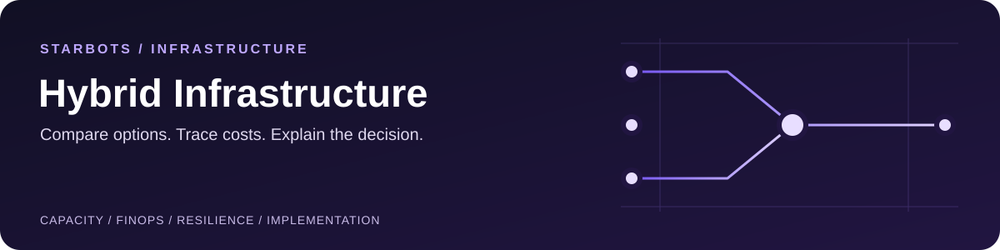

# Starbots Hybrid Infrastructure

**Compare infrastructure options, trace every cost, and explain the decision.** An offline Python CLI (`sb-hybrid`) and an agent skill that compare your current design with alternatives you supply and produce a cost and decision dossier for both the business owner and the implementation engineer.

[What it is](#what-it-is) · [What it's for](#what-its-for) · [What's included](#whats-included) · [Install](#install) · [Quick start](#quick-start) · [Use your own data](#use-your-own-data) · [Add the skill to your agent](#add-the-skill-to-your-agent) · [Limits](#limits) · [Resumen en español](#resumen-en-español)

## What it is

Starbots Hybrid Infrastructure evaluates a finite set of infrastructure designs for one steady-state workload, for example "everything on managed cloud", "local worker with cloud fallback" or "self-managed VM". You describe the company profile, each scenario and dated cost snapshots as versioned JSON. The engine checks mandatory constraints (availability, recovery time and point, residency, staffing, budget), estimates capacity analytically, and compares 12- and 36-month cash and allocated total cost of ownership (TCO) only between alternatives whose data is comparable. It writes a hash-manifested report: a 13-section dossier in JSON, Markdown and printable HTML, an executive summary, an implementation guide, architecture diagrams, a cost CSV and a 36-month cashflow CSV. It works without provider credentials or live pricing, and it never executes infrastructure changes.

## What it's for

It helps founders, CTOs, consultants and platform or FinOps engineers at small and mid-sized teams who need to make or explain an infrastructure decision with numbers that can be traced back to their inputs. Concrete uses:

- **Decide whether to move background workers to your own hardware** while keeping the database and a fallback in the cloud, and see the month in which the transition cost is recovered, if ever.
- **Expose hidden costs** such as data transfer, extra operations hours, power and replacement reserve, or a cloud fallback that turn an apparently cheaper quote into a loss.
- **Show when staying on a managed service is the better option,** with the alternative's backup, network, security and maintenance costs made explicit.
- **Reject alternatives that break mandatory requirements** (for example residency or recovery objectives, or not enough capacity for the declared workload) before ranking on cost.
- **Give a business owner and an engineer the same figures:** an executive summary plus an ordered implementation guide with owners, prerequisites, validation and stop conditions, migration and rollback.
- **Attach an independent security review** produced by [Starbots Security Skills](https://github.com/Starbots-devv/security-skills) to the exact proposal and verify it.

## What's included

- `src/starbots_hybrid/` — the `sb-hybrid` CLI (`validate`, `seal-bundle`, `analyze`, `dossier`, `verify-security`, `verify-subject`, `export-protocol`) and the optional `sb-aws-sim` local SQS simulator.
- [`skills/hybrid-infrastructure/SKILL.md`](skills/hybrid-infrastructure/SKILL.md) — an Agent Skill that teaches an AI agent the validate → analyze → dossier workflow, how to report results and when to stop.
- `contracts/1.0.0/` — JSON Schemas for the workload profile, scenario, cost snapshot, capacity assessment, evaluation result, change plan, approval envelope and execution record.
- `examples/flows/` — three complete fictional cases with inputs and generated reports; `examples/hybrid-saving/` — a starting bundle to copy; `examples/contracts/` — contract examples.
- `vendor/` — byte-pinned copies of the Security Skills protocol and local review policy, so Hybrid can verify a security review without importing that package.
- `docs/` — [usage and input format](docs/usage.md), [cost methodology](docs/cost-methodology.md) and the [SQS simulation](docs/aws-simulation.md).

### Example results

The three example flows use fictional companies and synthetic USD prices. Their figures are outputs of this tool on those inputs, not market prices or observed savings.

| Flow | Current / month | Proposed cash / month | Proposed TCO / month | Transition | Net cash at 12 / 36 months | Result |
| --- | ---: | ---: | ---: | ---: | ---: | --- |
| [01 · hybrid workers](examples/flows/flow-01/report/dossier.html) | 720 | 500 | 540 | 1,200 | +1,440 / +6,720 | Hybrid conditionally recommended; local-only fails mandatory constraints |
| [02 · hidden costs](examples/flows/flow-02/report/dossier.html) | 520 | 620 | 620 | 400 | −1,600 / −4,000 | Keep the current design |
| [03 · stay managed](examples/flows/flow-03/report/dossier.html) | 260 | 305 | 305 | 600 | −1,140 / −2,220 | Keep the managed service |

See the [flow guide](examples/flows/README.md) for the assumptions behind each case.

## Install

Requirements: Windows x64 and CPython 3.12. The hash-locked dependency files pin Windows x64 wheels.

```powershell
git clone https://github.com/Starbots-devv/hybrid-infrastructure.git
cd hybrid-infrastructure
py -3.12 -m venv .venv
.venv/Scripts/python.exe -m pip --no-cache-dir install --require-hashes -r requirements-dev.lock
.venv/Scripts/python.exe tools/stamp_build.py
.venv/Scripts/python.exe -m pip --no-cache-dir wheel --no-index --no-deps --no-build-isolation --wheel-dir dist .
.venv/Scripts/python.exe -m pip --no-cache-dir install --no-index --no-deps --find-links dist starbots-hybrid-infrastructure
.venv/Scripts/sb-hybrid.exe --help
```

`stamp_build.py` is optional: on a clean Git checkout it records the commit in the installed package so generated reports name their source; without it the producer is `UNRELEASED`. For the optional SQS simulator, also install `requirements-simulation.lock` with `--require-hashes` into the same environment (it adds `cryptography`).

## Quick start

Analyze the first example into a new directory, then open `dossier.html` in a browser:

```powershell
.venv/Scripts/sb-hybrid.exe validate --bundle examples/flows/flow-01/bundle.json
.venv/Scripts/sb-hybrid.exe analyze --bundle examples/flows/flow-01/bundle.json --as-of 2026-10-17T00:00:00Z --output-dir .local-output/flow-01
.venv/Scripts/sb-hybrid.exe dossier --evaluation .local-output/flow-01/evaluation.json --output-dir .local-output/flow-01-copy
```

The fixed `--as-of` is part of the example: its synthetic prices are valid until 2026-11-01, and a later date is rejected as stale on purpose. `dossier` re-renders a verified report without recalculating anything. Every output directory must be new.

A report contains `evaluation.json` (canonical figures), `dossier.md` / `dossier.html` (13 sections: decision, context, alternatives, architecture, resources, connections, capacity, economics, security and continuity, implementation, migration and rollback, operations, evidence and acceptance), `executive-summary.md`, `implementation-guide.md`, `architecture-current.svg`, `architecture-proposed.svg`, `costs.csv`, `cashflow.csv`, a limited `shareable-summary.html`, the copied inputs and SHA-256 manifests (`artifact-manifest.json`, `subject.json`, `subject-manifest.json`).

## Use your own data

1. Copy `examples/hybrid-saving` (or a whole flow) to a new directory.
2. Edit `profile.json`, the `scenario-*.json` files and the dated `prices-*.json` snapshots; optionally add `finops-*.json` 36-month plans. The [usage guide](docs/usage.md) and [cost methodology](docs/cost-methodology.md) describe every field and rule.
3. Seal, validate and analyze:

```powershell
.venv/Scripts/sb-hybrid.exe seal-bundle --bundle <your-copy>/bundle.json
.venv/Scripts/sb-hybrid.exe validate --bundle <your-copy>/bundle.json
.venv/Scripts/sb-hybrid.exe analyze --bundle <your-copy>/bundle.json --as-of <UTC> --output-dir .local-output/my-company
```

`seal-bundle` only refreshes input hashes; it is not an approval. Use `--policy strict-analysis-1.0.0` to keep unmeasured capacity UNKNOWN and withhold a recommendation. Errors are printed as JSON with a code (for example `HASH_MISMATCH`, `EVIDENCE_STALE`, `INCOMPARABLE_COSTS`) and exit code 2.

To attach a security review, generate one with Starbots Security Skills for the report's `subject.json`, keep its SHA-256 separately, and verify it:

```powershell
.venv/Scripts/sb-hybrid.exe verify-security --review-dir <review> --proposal .local-output/my-company/subject.json --assessment-sha256 <separately-kept-sha256> --client-id <client> --project-id <project> --as-of <UTC>
```

## Add the skill to your agent

Copy the folder `skills/hybrid-infrastructure` into your project's skills directory:

| Agent | Destination |
| --- | --- |
| Claude Code | `<your-project>/.claude/skills/hybrid-infrastructure/` |
| Codex | `<your-project>/.agents/skills/hybrid-infrastructure/` |
| Kiro | `<your-project>/.kiro/skills/hybrid-infrastructure/` |

The skill calls the `sb-hybrid` CLI, so install the CLI in the environment your agent uses. Then ask, for example, *"Compare our current worker setup with a local worker plus cloud fallback using the hybrid-infrastructure skill"*.

## Limits

- **No live data and no execution.** No provider credentials, live or scraped pricing, billing or inventory import, provisioning or deployment. Recommendations are conditional on your inputs and `execution_eligible` is always false.
- **Model scope.** One steady-state workload per bundle, a finite set of alternatives you supply and one cost snapshot per scenario. Capacity is an analytical estimate, not a load test. Results are pre-tax; currency conversion happens only through an explicit dated FX quote.
- **Security stays UNKNOWN** unless you attach and verify a separate security review, and even a verified fixture review does not prove the security of a real company's infrastructure.
- **SQS simulation only.** `sb-aws-sim` is an in-memory simulation of one SQS queue creation for demonstrating signed, journaled change control. It has no AWS SDK, no credentials path and no real transport; `APPLY_AWS` is always denied.
- **Platform.** Installation and tests are verified on Windows x64 with CPython 3.12. Other platforms need their own hash-locked requirements.
- **Agent hosts.** Automatic discovery and routing of the skill by Claude Code, Codex or Kiro is not measured.

## Tests

```powershell
.venv/Scripts/python.exe -m pip --no-cache-dir install --require-hashes -r requirements-simulation.lock
.venv/Scripts/python.exe -m unittest discover -s tests -p "test_*.py" -v
.venv/Scripts/python.exe -m unittest discover -s tests/integration -p "test_*.py" -v
```

Both suites run locally on synthetic data with no network. The simulator tests need the `cryptography` dependency from `requirements-simulation.lock`.

## License

Apache License 2.0. See [LICENSE](LICENSE), [NOTICE](NOTICE) and [third-party notices](THIRD_PARTY_NOTICES.md). Security reports: [SECURITY.md](SECURITY.md). Contributions: [CONTRIBUTING.md](CONTRIBUTING.md).

## Resumen en español

**Starbots Hybrid Infrastructure** es una CLI de Python (`sb-hybrid`) y una skill para agentes de IA que comparan, sin conexión, tu diseño de infraestructura actual con alternativas que tú defines (todo en la nube gestionada, worker local con respaldo en la nube, VM autogestionada, etc.) para una carga de trabajo estable. Verifica restricciones obligatorias (disponibilidad, RTO/RPO, residencia de datos, personal, presupuesto), estima la capacidad de forma analítica y compara caja y TCO a 12 y 36 meses solo entre alternativas comparables. Genera un dossier de decisión de 13 secciones en JSON, Markdown y HTML, un resumen ejecutivo, una guía de implementación, diagramas, CSV de costes y flujo de caja a 36 meses, todo con manifiestos SHA-256.

**Para qué sirve:** decidir si mover workers a hardware propio manteniendo la base de datos y un respaldo en la nube; sacar a la luz costes ocultos (transferencia, operación, energía, respaldo) que convierten un ahorro aparente en pérdida; demostrar cuándo conviene quedarse en un servicio gestionado; descartar alternativas que incumplen requisitos obligatorios; y dar al responsable de negocio y al ingeniero las mismas cifras.

**Incluye:** la CLI, los contratos JSON, tres casos ficticios completos con informes generados, un bundle de partida, la skill `skills/hybrid-infrastructure/SKILL.md` y un simulador local opcional de SQS.

**Instalación:** Windows x64 y CPython 3.12, dependencias con hashes fijados, construcción local del wheel y `sb-hybrid --help`. Flujo: copiar un ejemplo, editar los datos, `seal-bundle`, `validate`, `analyze` y `dossier`. Para usar la skill, copia `skills/hybrid-infrastructure` en `.claude/skills/`, `.agents/skills/` o `.kiro/skills/` de tu proyecto.

**Límites:** sin credenciales de proveedores, sin precios en vivo y sin autoridad de ejecución; las recomendaciones son condicionales a tus datos. Una carga de trabajo estable por bundle; capacidad analítica, no prueba de carga; resultados antes de impuestos. La seguridad queda como UNKNOWN salvo que adjuntes y verifiques una revisión independiente. El simulador SQS es solo en memoria. Instalación verificada en Windows x64 con CPython 3.12.

**Licencia:** Apache 2.0.

---

Made by Starbots — https://starbots.dev
