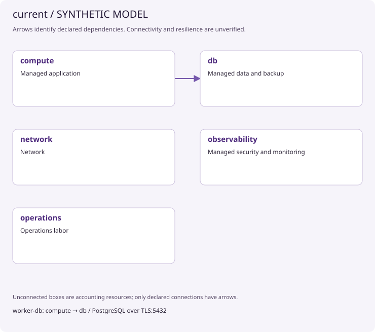

# Starbots Hybrid Infrastructure

Maple Service — fictional organization

**SYNTHETIC / ESTIMATED — execution blocked**

[Full dossier](dossier.html) · [Canonical JSON](evaluation.json) · [Cost lines](costs.csv)

## 1. Executive decision

Maple Service — fictional organization — CONDITIONAL recommendation: current. Savings are ESTIMATED.

Lowest allocated TCO over the requested horizon among model-compatible, budget-compatible alternatives.

Mandatory security remains UNKNOWN; no scenario is demonstrated feasible.

incremental&#95;cash: monthly saving 0 USD; net12 0; net36 0; investment 0; recovery month 1.

allocated&#95;tco: monthly saving 0 USD; net12 0; net36 0; investment 0; recovery month 1.

## 2. Context and evidence

Compare complete 12- and 36-month synthetic costs before changing architecture

Retain a managed data source and demonstrate recovery independently

All demo facts and rates are synthetic assumptions; evidence and open questions remain explicit.

### Business profile

| Field | Value |
| --- | --- |
| commercial | commitments: None declared; currency: USD; horizon&#95;months: 36; monthly&#95;budget: 900 |
| company&#95;name | Maple Service — fictional organization |
| current&#95;system | description: Managed application already meets modeled objectives; VM alternative transfers backup and patching responsibility; resource&#95;ids: compute; db; network; observability; operations |
| data&#95;policy | classification: Synthetic order events; no customer records; compliance&#95;constraints: No regulatory certification is claimed; residency: EU |
| environments | development |
| evidence&#95;refs | None declared |
| geography | EU model boundary |
| goals | Compare complete 12- and 36-month synthetic costs before changing architecture; Retain a managed data source and demonstrate recovery independently |
| new&#95;system | false |
| synthetic | true |
| team&#95;operations | hours&#95;per&#95;month: 20; incident&#95;response: Page engineer, pause consumers, retain queue, restore cloud consumers after checks; on&#95;call: Business hours; incident escalation requires validation; owner: Platform engineer; skills: Python operations; Networking; Database backup and restore |

### Workload inputs

| Field | Value |
| --- | --- |
| api-requests / arrival&#95;rate&#95;per&#95;second | 1 |
| api-requests / assumptions | One synthetic request or job per second; service time is unmeasured.; No conversion from users to requests; retry amplification needs a load test. |
| api-requests / concurrency | 4 |
| api-requests / db&#95;connections | 10 |
| api-requests / evidence&#95;level | synthetic |
| api-requests / id | api-requests |
| api-requests / inference&#95;cost&#95;monthly | 0 |
| api-requests / kind | api |
| api-requests / memory&#95;gib | 8 |
| api-requests / queue&#95;depth | 100 |
| api-requests / service&#95;time&#95;seconds | 2 |

## 3. Alternatives and rejects

current: UNDEMONSTRATED. verified-security: UNKNOWN

vm: UNDEMONSTRATED. verified-security: UNKNOWN

### current — UNDEMONSTRATED

| ID / dimension | Rule target / observation | State / mandatory | Evidence / rationale |
| --- | --- | --- | --- |
| availability / availability | 99.5 / 99.9 | PASS / True | synthetic / Unmeasured design hypothesis; prove by load test, restore drill or operations log; declared observation, not independently verified |
| restore / rto | 60 / 45 | PASS / True | synthetic / Unmeasured design hypothesis; prove by load test, restore drill or operations log; declared observation, not independently verified |
| data-loss / rpo | 15 / 10 | PASS / True | synthetic / Unmeasured design hypothesis; prove by load test, restore drill or operations log; declared observation, not independently verified |
| staffing / staffing | 20 / 18 | PASS / True | synthetic / Unmeasured design hypothesis; prove by load test, restore drill or operations log; declared observation, not independently verified |
| eu-residency / residency | EU / EU | PASS / True | synthetic / All data-bearing dependencies must satisfy the mandatory EU boundary; declared observation, not independently verified |
| model-throughput / capacity | 1 / 4 | PASS / True | synthetic / Analytical synthetic model only; benchmark and load test required |
| model-db-connections / capacity | 10 / 20 | PASS / True | synthetic / Analytical synthetic model only; benchmark and load test required |
| model-network / capacity | 10 / 100 | PASS / True | synthetic / Analytical synthetic model only; benchmark and load test required |
| verified-security / security | Exact-subject verified security coverage / UNKNOWN — required input or evidence | UNKNOWN / True | unknown / No independently verified exact-subject security review is bound to this analysis |

### vm — UNDEMONSTRATED

| ID / dimension | Rule target / observation | State / mandatory | Evidence / rationale |
| --- | --- | --- | --- |
| availability / availability | 99.5 / 99.9 | PASS / True | synthetic / Unmeasured design hypothesis; prove by load test, restore drill or operations log; declared observation, not independently verified |
| restore / rto | 60 / 45 | PASS / True | synthetic / Unmeasured design hypothesis; prove by load test, restore drill or operations log; declared observation, not independently verified |
| data-loss / rpo | 15 / 10 | PASS / True | synthetic / Unmeasured design hypothesis; prove by load test, restore drill or operations log; declared observation, not independently verified |
| staffing / staffing | 20 / 16 | PASS / True | synthetic / Unmeasured design hypothesis; prove by load test, restore drill or operations log; declared observation, not independently verified |
| eu-residency / residency | EU / EU | PASS / True | synthetic / All data-bearing dependencies must satisfy the mandatory EU boundary; declared observation, not independently verified |
| model-throughput / capacity | 1 / 2 | PASS / True | synthetic / Analytical synthetic model only; benchmark and load test required |
| model-db-connections / capacity | 10 / 20 | PASS / True | synthetic / Analytical synthetic model only; benchmark and load test required |
| model-network / capacity | 10 / 100 | PASS / True | synthetic / Analytical synthetic model only; benchmark and load test required |
| verified-security / security | Exact-subject verified security coverage / UNKNOWN — required input or evidence | UNKNOWN / True | unknown / No independently verified exact-subject security review is bound to this analysis |

## 4. Current and proposed architecture

Diagrams show declared nodes and directed edges. They do not prove availability, compatibility or live connectivity.

Failure domains sharing power or uplink have no demonstrated independence.

### current trust and failure domains

| Field | Value |
| --- | --- |
| Trust boundaries | Worker host; Cloud control plane; Managed database |
| Failure domains | correlated&#95;with: site-power-and-network; id: worker-site; independence&#95;evidence: UNKNOWN — required input or evidence; network: Single site uplink; outage test required; power: Single synthetic site; no independence proven; resource&#95;ids: compute |
| Actions | actions: keep; resource&#95;id: compute; actions: keep; resource&#95;id: db; actions: keep; resource&#95;id: network; actions: keep; resource&#95;id: observability; actions: keep; resource&#95;id: operations |

### vm trust and failure domains

| Field | Value |
| --- | --- |
| Trust boundaries | Self-managed VM; Managed backup endpoint |
| Failure domains | correlated&#95;with: site-power-and-network; id: worker-site; independence&#95;evidence: UNKNOWN — required input or evidence; network: Single site uplink; outage test required; power: Single synthetic site; no independence proven; resource&#95;ids: compute |
| Actions | actions: keep; resource&#95;id: compute; actions: keep; resource&#95;id: network; actions: keep; resource&#95;id: operations; actions: keep; resource&#95;id: migration |

## 5. Resource bill

Each declared resource is listed with owner, quantity and region. A resource without a priced line is explicitly identified; this is an exclusion, not a zero-cost claim.

### current resource bill

| ID / service | Provider / region | Size / quantity | Owner / allocation |
| --- | --- | --- | --- |
| compute / Managed application | Synthetic architecture model / EU model boundary | Explicit capacity assumptions; no vendor SKU / 1 | Platform engineer / priced |
| db / Managed data and backup | Synthetic architecture model / EU model boundary | Explicit capacity assumptions; no vendor SKU / 1 | Platform engineer / priced |
| network / Network | Synthetic architecture model / EU model boundary | Explicit capacity assumptions; no vendor SKU / 1 | Platform engineer / priced |
| observability / Managed security and monitoring | Synthetic architecture model / EU model boundary | Explicit capacity assumptions; no vendor SKU / 1 | Platform engineer / priced |
| operations / Operations labor | Synthetic architecture model / EU model boundary | Explicit capacity assumptions; no vendor SKU / 1 | Platform engineer / priced |

### vm resource bill

| ID / service | Provider / region | Size / quantity | Owner / allocation |
| --- | --- | --- | --- |
| compute / Self-managed VM | Synthetic architecture model / EU model boundary | Explicit capacity assumptions; no vendor SKU / 1 | Platform engineer / priced |
| network / Backup, network, and security | Synthetic architecture model / EU model boundary | Explicit capacity assumptions; no vendor SKU / 1 | Platform engineer / priced |
| operations / VM operations and maintenance | Synthetic architecture model / EU model boundary | Explicit capacity assumptions; no vendor SKU / 1 | Platform engineer / priced |
| migration / Transition and training | Synthetic architecture model / EU model boundary | Explicit capacity assumptions; no vendor SKU / 1 | Platform engineer / priced |

## 6. Connection matrix

Required DNS, identities, secrets, TLS roots and routes remain inputs. No connection test has been executed; missing inputs block implementation.

### current / worker-db

| Connection field | Required design / validation |
| --- | --- |
| connectivity&#95;test | Resolve approved hostname, validate TLS and perform a scoped dry-run transaction; not executed |
| cost&#95;line&#95;ids | network |
| destination | db |
| direction | outbound |
| dns | UNKNOWN — required input or evidence |
| firewall&#95;route | Outbound only; allow destination service and port after review |
| id | worker-db |
| identity | Dedicated least-privilege workload identity; no shared admin key |
| permissions | Write only application schema |
| port | 5432 |
| protocol | PostgreSQL over TLS |
| required&#95;inputs | Approved hostname; Certificate trust root; Scoped identity; Reviewed firewall rule |
| secret&#95;refs | secret://required/workload-identity |
| source | compute |
| tls | TLS with verified server certificate; actual hostname and trust chain required |
| traffic&#95;gb&#95;month | 10 |
| trust&#95;boundary | Cloud service boundary |

### vm / vm-network

| Connection field | Required design / validation |
| --- | --- |
| connectivity&#95;test | Resolve approved hostname, validate TLS and perform a scoped dry-run transaction; not executed |
| cost&#95;line&#95;ids | network |
| destination | network |
| direction | outbound |
| dns | UNKNOWN — required input or evidence |
| firewall&#95;route | Outbound only; allow destination service and port after review |
| id | vm-network |
| identity | Dedicated least-privilege workload identity; no shared admin key |
| permissions | Egress only to approved backup or application endpoint |
| port | 443 |
| protocol | HTTPS |
| required&#95;inputs | Approved hostname; Certificate trust root; Scoped identity; Reviewed firewall rule |
| secret&#95;refs | secret://required/workload-identity |
| source | compute |
| tls | TLS with verified server certificate; actual hostname and trust chain required |
| traffic&#95;gb&#95;month | 10 |
| trust&#95;boundary | Cloud service boundary |

## 7. Capacity and service objectives

Capacity is a steady-state analytical hypothesis. It predicts neither concurrent users nor latency percentiles.

Trigger: stop rollout when arrival rate exceeds modeled service capacity, a connection limit is reached, or queue age breaches the approved objective.

### current capacity

| Field | Value |
| --- | --- |
| assumptions | Synthetic steady-state slots and two-second service time; no measured benchmark.; Retry bursts, I/O ceilings and tail latency require separate tests. |
| bottlenecks | None declared |
| configuration | Declared parallel slots, memory, database connections and network ceilings |
| constraint&#95;results | actual: 4; dimension: capacity; evidence&#95;level: synthetic; id: model-throughput; mandatory: true; rationale: Analytical synthetic model only; benchmark and load test required; state: PASS; threshold: 1; actual: 20; dimension: capacity; evidence&#95;level: synthetic; id: model-db-connections; mandatory: true; rationale: Analytical synthetic model only; benchmark and load test required; state: PASS; threshold: 10; actual: 100; dimension: capacity; evidence&#95;level: synthetic; id: model-network; mandatory: true; rationale: Analytical synthetic model only; benchmark and load test required; state: PASS; threshold: 10 |
| critical&#95;paths | worker -&gt; durable queue -&gt; managed database |
| demand&#95;case | Managed application already meets modeled objectives; VM alternative transfers backup and patching responsibility |
| estimated&#95;capacity&#95;rps | 4 |
| evidence&#95;refs | None declared |
| failure&#95;domains | correlated&#95;with: site-power-and-network; id: worker-site; independence&#95;evidence: UNKNOWN — required input or evidence; network: Single site uplink; outage test required; power: Single synthetic site; no independence proven; resource&#95;ids: compute |
| headroom&#95;percent | 75 |
| limits | No measured throughput, latency percentile, queue-drain or restore test is supplied.; Correlated power/network failures and cloud fallback capacity need independent tests.; Single workload, steady arrival rate and equal service times; no users-to-RPS conversion. |
| measured&#95;or&#95;estimated | estimated |
| method | min&#40;parallel slots, floor&#40;memory / memory per job&#41;&#41; / service time |
| recovery&#95;objectives | acceptance&#95;condition: gte; id: availability; indicator: availability; measurement: Availability percentage; test is pending; target: 99.5; window: Monthly steady demand; recovery per incident; acceptance&#95;condition: lte; id: restore; indicator: rto; measurement: Minutes to restore service; drill is pending; target: 60; window: Monthly steady demand; recovery per incident; acceptance&#95;condition: lte; id: data-loss; indicator: rpo; measurement: Minutes of potentially lost writes; drill is pending; target: 15; window: Monthly steady demand; recovery per incident; acceptance&#95;condition: lte; id: staffing; indicator: staffing; measurement: Maintenance hours per month; target: 20; window: Monthly steady demand; recovery per incident |
| restoration&#95;test&#95;refs | None declared |
| scenario&#95;id | current |
| scenario&#95;sha256 | 8cec2b1f6a43adcb77bc0978a36fa759fd8871d924275ad0f8c8f54acb15cd70 |
| target&#95;load&#95;rps | 1 |

### vm capacity

| Field | Value |
| --- | --- |
| assumptions | Synthetic steady-state slots and two-second service time; no measured benchmark.; Retry bursts, I/O ceilings and tail latency require separate tests. |
| bottlenecks | None declared |
| configuration | Declared parallel slots, memory, database connections and network ceilings |
| constraint&#95;results | actual: 2; dimension: capacity; evidence&#95;level: synthetic; id: model-throughput; mandatory: true; rationale: Analytical synthetic model only; benchmark and load test required; state: PASS; threshold: 1; actual: 20; dimension: capacity; evidence&#95;level: synthetic; id: model-db-connections; mandatory: true; rationale: Analytical synthetic model only; benchmark and load test required; state: PASS; threshold: 10; actual: 100; dimension: capacity; evidence&#95;level: synthetic; id: model-network; mandatory: true; rationale: Analytical synthetic model only; benchmark and load test required; state: PASS; threshold: 10 |
| critical&#95;paths | worker -&gt; durable queue -&gt; managed database |
| demand&#95;case | Managed application already meets modeled objectives; VM alternative transfers backup and patching responsibility |
| estimated&#95;capacity&#95;rps | 2 |
| evidence&#95;refs | None declared |
| failure&#95;domains | correlated&#95;with: site-power-and-network; id: worker-site; independence&#95;evidence: UNKNOWN — required input or evidence; network: Single site uplink; outage test required; power: Single synthetic site; no independence proven; resource&#95;ids: compute |
| headroom&#95;percent | 50 |
| limits | No measured throughput, latency percentile, queue-drain or restore test is supplied.; Correlated power/network failures and cloud fallback capacity need independent tests.; Single workload, steady arrival rate and equal service times; no users-to-RPS conversion. |
| measured&#95;or&#95;estimated | estimated |
| method | min&#40;parallel slots, floor&#40;memory / memory per job&#41;&#41; / service time |
| recovery&#95;objectives | acceptance&#95;condition: gte; id: availability; indicator: availability; measurement: Availability percentage; test is pending; target: 99.5; window: Monthly steady demand; recovery per incident; acceptance&#95;condition: lte; id: restore; indicator: rto; measurement: Minutes to restore service; drill is pending; target: 60; window: Monthly steady demand; recovery per incident; acceptance&#95;condition: lte; id: data-loss; indicator: rpo; measurement: Minutes of potentially lost writes; drill is pending; target: 15; window: Monthly steady demand; recovery per incident; acceptance&#95;condition: lte; id: staffing; indicator: staffing; measurement: Maintenance hours per month; target: 20; window: Monthly steady demand; recovery per incident |
| restoration&#95;test&#95;refs | None declared |
| scenario&#95;id | vm |
| scenario&#95;sha256 | d5c94f6c237a3b11ff7130f0f9397c571d7243bb787347dfe17e49a899b96b46 |
| target&#95;load&#95;rps | 1 |

## 8. Economics and recovery

All views are derived from the canonical cost rows and series. Cash excludes allocated depreciation; TCO includes it.

Migration/training is one-time investment; already owned hardware has no upfront purchase in this example. Hash-bound monthly FinOps assumptions produce the 36-month series.

### current / incremental&#95;cash totals

| Field | Value |
| --- | --- |
| accounting&#95;basis | list |
| complete | true |
| currency | USD |
| known&#95;monthly&#95;subtotal | 260 |
| monthly&#95;total | 260 |
| one&#95;time&#95;total | 0 |
| rounding&#95;delta | 0 |
| scenario&#95;id | current |
| stale&#95;line&#95;ids | None declared |
| unknown&#95;line&#95;ids | None declared |
| unrounded&#95;monthly&#95;total | 260 |
| view | incremental&#95;cash |

### current / incremental&#95;cash cost lines

| Row ID | Resource / service | Quantity / rate / unit | Amount / currency | Source / evidence |
| --- | --- | --- | --- | --- |
| current&#124;incremental&#95;cash&#124;compute&#124;monthly | compute / Managed application | 1 / 110 / month | 110 / USD | synthetic://flows/current/compute / synthetic / Nominal USD, no FX or inflation; tax UNKNOWN.; Explicit synthetic full-cost allocation.; Decimal precision=50; ROUND&#95;HALF&#95;UP; inexact=false; Period: calendar&#95;month starting 2026-10; hourly quantity uses actual calendar days or explicit fixed 730 hours.; Month 1 of the hash-bound FinOps schedule; later months appear in the monthly series. |
| current&#124;incremental&#95;cash&#124;db&#124;monthly | db / Managed data and backup | 1 / 60 / month | 60 / USD | synthetic://flows/current/db / synthetic / Nominal USD, no FX or inflation; tax UNKNOWN.; Explicit synthetic full-cost allocation.; Decimal precision=50; ROUND&#95;HALF&#95;UP; inexact=false; Period: calendar&#95;month starting 2026-10; hourly quantity uses actual calendar days or explicit fixed 730 hours.; Month 1 of the hash-bound FinOps schedule; later months appear in the monthly series. |
| current&#124;incremental&#95;cash&#124;network&#124;monthly | network / Network | 1 / 30 / month | 30 / USD | synthetic://flows/current/network / synthetic / Nominal USD, no FX or inflation; tax UNKNOWN.; Explicit synthetic full-cost allocation.; Decimal precision=50; ROUND&#95;HALF&#95;UP; inexact=false; Period: calendar&#95;month starting 2026-10; hourly quantity uses actual calendar days or explicit fixed 730 hours.; Month 1 of the hash-bound FinOps schedule; later months appear in the monthly series. |
| current&#124;incremental&#95;cash&#124;observability&#124;monthly | observability / Managed security and monitoring | 1 / 20 / month | 20 / USD | synthetic://flows/current/observability / synthetic / Nominal USD, no FX or inflation; tax UNKNOWN.; Explicit synthetic full-cost allocation.; Decimal precision=50; ROUND&#95;HALF&#95;UP; inexact=false; Period: calendar&#95;month starting 2026-10; hourly quantity uses actual calendar days or explicit fixed 730 hours.; Month 1 of the hash-bound FinOps schedule; later months appear in the monthly series. |
| current&#124;incremental&#95;cash&#124;operations&#124;monthly | operations / Operations labor | 1 / 40 / month | 40 / USD | synthetic://flows/current/operations / synthetic / Nominal USD, no FX or inflation; tax UNKNOWN.; Explicit synthetic full-cost allocation.; Decimal precision=50; ROUND&#95;HALF&#95;UP; inexact=false; Period: calendar&#95;month starting 2026-10; hourly quantity uses actual calendar days or explicit fixed 730 hours.; Month 1 of the hash-bound FinOps schedule; later months appear in the monthly series. |

### current / allocated&#95;tco totals

| Field | Value |
| --- | --- |
| accounting&#95;basis | list |
| complete | true |
| currency | USD |
| known&#95;monthly&#95;subtotal | 260 |
| monthly&#95;total | 260 |
| one&#95;time&#95;total | 0 |
| rounding&#95;delta | 0 |
| scenario&#95;id | current |
| stale&#95;line&#95;ids | None declared |
| unknown&#95;line&#95;ids | None declared |
| unrounded&#95;monthly&#95;total | 260 |
| view | allocated&#95;tco |

### current / allocated&#95;tco cost lines

| Row ID | Resource / service | Quantity / rate / unit | Amount / currency | Source / evidence |
| --- | --- | --- | --- | --- |
| current&#124;allocated&#95;tco&#124;compute&#124;monthly | compute / Managed application | 1 / 110 / month | 110 / USD | synthetic://flows/current/compute / synthetic / Nominal USD, no FX or inflation; tax UNKNOWN.; Explicit synthetic full-cost allocation.; Decimal precision=50; ROUND&#95;HALF&#95;UP; inexact=false; Period: calendar&#95;month starting 2026-10; hourly quantity uses actual calendar days or explicit fixed 730 hours.; Month 1 of the hash-bound FinOps schedule; later months appear in the monthly series. |
| current&#124;allocated&#95;tco&#124;db&#124;monthly | db / Managed data and backup | 1 / 60 / month | 60 / USD | synthetic://flows/current/db / synthetic / Nominal USD, no FX or inflation; tax UNKNOWN.; Explicit synthetic full-cost allocation.; Decimal precision=50; ROUND&#95;HALF&#95;UP; inexact=false; Period: calendar&#95;month starting 2026-10; hourly quantity uses actual calendar days or explicit fixed 730 hours.; Month 1 of the hash-bound FinOps schedule; later months appear in the monthly series. |
| current&#124;allocated&#95;tco&#124;network&#124;monthly | network / Network | 1 / 30 / month | 30 / USD | synthetic://flows/current/network / synthetic / Nominal USD, no FX or inflation; tax UNKNOWN.; Explicit synthetic full-cost allocation.; Decimal precision=50; ROUND&#95;HALF&#95;UP; inexact=false; Period: calendar&#95;month starting 2026-10; hourly quantity uses actual calendar days or explicit fixed 730 hours.; Month 1 of the hash-bound FinOps schedule; later months appear in the monthly series. |
| current&#124;allocated&#95;tco&#124;observability&#124;monthly | observability / Managed security and monitoring | 1 / 20 / month | 20 / USD | synthetic://flows/current/observability / synthetic / Nominal USD, no FX or inflation; tax UNKNOWN.; Explicit synthetic full-cost allocation.; Decimal precision=50; ROUND&#95;HALF&#95;UP; inexact=false; Period: calendar&#95;month starting 2026-10; hourly quantity uses actual calendar days or explicit fixed 730 hours.; Month 1 of the hash-bound FinOps schedule; later months appear in the monthly series. |
| current&#124;allocated&#95;tco&#124;operations&#124;monthly | operations / Operations labor | 1 / 40 / month | 40 / USD | synthetic://flows/current/operations / synthetic / Nominal USD, no FX or inflation; tax UNKNOWN.; Explicit synthetic full-cost allocation.; Decimal precision=50; ROUND&#95;HALF&#95;UP; inexact=false; Period: calendar&#95;month starting 2026-10; hourly quantity uses actual calendar days or explicit fixed 730 hours.; Month 1 of the hash-bound FinOps schedule; later months appear in the monthly series. |

### vm / incremental&#95;cash totals

| Field | Value |
| --- | --- |
| accounting&#95;basis | list |
| complete | true |
| currency | USD |
| known&#95;monthly&#95;subtotal | 305 |
| monthly&#95;total | 305 |
| one&#95;time&#95;total | 600 |
| rounding&#95;delta | 0 |
| scenario&#95;id | vm |
| stale&#95;line&#95;ids | None declared |
| unknown&#95;line&#95;ids | None declared |
| unrounded&#95;monthly&#95;total | 305 |
| view | incremental&#95;cash |

### vm / incremental&#95;cash cost lines

| Row ID | Resource / service | Quantity / rate / unit | Amount / currency | Source / evidence |
| --- | --- | --- | --- | --- |
| vm&#124;incremental&#95;cash&#124;compute&#124;monthly | compute / Self-managed VM | 1 / 120 / month | 120 / USD | synthetic://flows/vm/compute / synthetic / Nominal USD, no FX or inflation; tax UNKNOWN.; Explicit synthetic full-cost allocation.; Decimal precision=50; ROUND&#95;HALF&#95;UP; inexact=false; Period: calendar&#95;month starting 2026-10; hourly quantity uses actual calendar days or explicit fixed 730 hours.; Month 1 of the hash-bound FinOps schedule; later months appear in the monthly series. |
| vm&#124;incremental&#95;cash&#124;network&#124;monthly | network / Backup, network, and security | 1 / 60 / month | 60 / USD | synthetic://flows/vm/network / synthetic / Nominal USD, no FX or inflation; tax UNKNOWN.; Explicit synthetic full-cost allocation.; Decimal precision=50; ROUND&#95;HALF&#95;UP; inexact=false; Period: calendar&#95;month starting 2026-10; hourly quantity uses actual calendar days or explicit fixed 730 hours.; Month 1 of the hash-bound FinOps schedule; later months appear in the monthly series. |
| vm&#124;incremental&#95;cash&#124;operations&#124;monthly | operations / VM operations and maintenance | 1 / 125 / month | 125 / USD | synthetic://flows/vm/operations / synthetic / Nominal USD, no FX or inflation; tax UNKNOWN.; Explicit synthetic full-cost allocation.; Decimal precision=50; ROUND&#95;HALF&#95;UP; inexact=false; Period: calendar&#95;month starting 2026-10; hourly quantity uses actual calendar days or explicit fixed 730 hours.; Month 1 of the hash-bound FinOps schedule; later months appear in the monthly series. |
| vm&#124;incremental&#95;cash&#124;migration&#124;one&#95;time | migration / Transition and training | 1 / 600 / one&#95;time | 600 / USD | synthetic://flows/vm/migration / synthetic / Nominal USD, no FX or inflation; tax UNKNOWN.; Explicit synthetic full-cost allocation.; Decimal precision=50; ROUND&#95;HALF&#95;UP; inexact=false; Period: calendar&#95;month starting 2026-10; hourly quantity uses actual calendar days or explicit fixed 730 hours. |

### vm / allocated&#95;tco totals

| Field | Value |
| --- | --- |
| accounting&#95;basis | list |
| complete | true |
| currency | USD |
| known&#95;monthly&#95;subtotal | 305 |
| monthly&#95;total | 305 |
| one&#95;time&#95;total | 600 |
| rounding&#95;delta | 0 |
| scenario&#95;id | vm |
| stale&#95;line&#95;ids | None declared |
| unknown&#95;line&#95;ids | None declared |
| unrounded&#95;monthly&#95;total | 305 |
| view | allocated&#95;tco |

### vm / allocated&#95;tco cost lines

| Row ID | Resource / service | Quantity / rate / unit | Amount / currency | Source / evidence |
| --- | --- | --- | --- | --- |
| vm&#124;allocated&#95;tco&#124;compute&#124;monthly | compute / Self-managed VM | 1 / 120 / month | 120 / USD | synthetic://flows/vm/compute / synthetic / Nominal USD, no FX or inflation; tax UNKNOWN.; Explicit synthetic full-cost allocation.; Decimal precision=50; ROUND&#95;HALF&#95;UP; inexact=false; Period: calendar&#95;month starting 2026-10; hourly quantity uses actual calendar days or explicit fixed 730 hours.; Month 1 of the hash-bound FinOps schedule; later months appear in the monthly series. |
| vm&#124;allocated&#95;tco&#124;network&#124;monthly | network / Backup, network, and security | 1 / 60 / month | 60 / USD | synthetic://flows/vm/network / synthetic / Nominal USD, no FX or inflation; tax UNKNOWN.; Explicit synthetic full-cost allocation.; Decimal precision=50; ROUND&#95;HALF&#95;UP; inexact=false; Period: calendar&#95;month starting 2026-10; hourly quantity uses actual calendar days or explicit fixed 730 hours.; Month 1 of the hash-bound FinOps schedule; later months appear in the monthly series. |
| vm&#124;allocated&#95;tco&#124;operations&#124;monthly | operations / VM operations and maintenance | 1 / 125 / month | 125 / USD | synthetic://flows/vm/operations / synthetic / Nominal USD, no FX or inflation; tax UNKNOWN.; Explicit synthetic full-cost allocation.; Decimal precision=50; ROUND&#95;HALF&#95;UP; inexact=false; Period: calendar&#95;month starting 2026-10; hourly quantity uses actual calendar days or explicit fixed 730 hours.; Month 1 of the hash-bound FinOps schedule; later months appear in the monthly series. |
| vm&#124;allocated&#95;tco&#124;migration&#124;one&#95;time | migration / Transition and training | 1 / 600 / one&#95;time | 600 / USD | synthetic://flows/vm/migration / synthetic / Nominal USD, no FX or inflation; tax UNKNOWN.; Explicit synthetic full-cost allocation.; Decimal precision=50; ROUND&#95;HALF&#95;UP; inexact=false; Period: calendar&#95;month starting 2026-10; hourly quantity uses actual calendar days or explicit fixed 730 hours. |

### Comparable monthly economics

| Scenario / view | Month 1 saving | Net12 / net36 | Investment / recovery | Comparability |
| --- | --- | --- | --- | --- |
| current / incremental&#95;cash | 0 USD | 0 / 0 | 0 / 1 | True / None declared |
| current / allocated&#95;tco | 0 USD | 0 / 0 | 0 / 1 | True / None declared |
| vm / incremental&#95;cash | -45 USD | -1140 / -2220 | 600 / UNKNOWN — required input or evidence | True / Decimal inexact flag set by division/presentation; declared context preserved |
| vm / allocated&#95;tco | -45 USD | -1140 / -2220 | 600 / UNKNOWN — required input or evidence | True / Decimal inexact flag set by division/presentation; declared context preserved |

### current / incremental&#95;cash monthly series

| Month | Baseline | Proposed | Saving | Cumulative net |
| --- | --- | --- | --- | --- |
| Month 1 | 260 | 260 | 0 | 0 |
| Month 2 | 260 | 260 | 0 | 0 |
| Month 3 | 260 | 260 | 0 | 0 |
| Month 4 | 260 | 260 | 0 | 0 |
| Month 5 | 260 | 260 | 0 | 0 |
| Month 6 | 260 | 260 | 0 | 0 |
| Month 7 | 260 | 260 | 0 | 0 |
| Month 8 | 260 | 260 | 0 | 0 |
| Month 9 | 260 | 260 | 0 | 0 |
| Month 10 | 260 | 260 | 0 | 0 |
| Month 11 | 260 | 260 | 0 | 0 |
| Month 12 | 260 | 260 | 0 | 0 |
| Month 13 | 260 | 260 | 0 | 0 |
| Month 14 | 260 | 260 | 0 | 0 |
| Month 15 | 260 | 260 | 0 | 0 |
| Month 16 | 260 | 260 | 0 | 0 |
| Month 17 | 260 | 260 | 0 | 0 |
| Month 18 | 260 | 260 | 0 | 0 |
| Month 19 | 260 | 260 | 0 | 0 |
| Month 20 | 260 | 260 | 0 | 0 |
| Month 21 | 260 | 260 | 0 | 0 |
| Month 22 | 260 | 260 | 0 | 0 |
| Month 23 | 260 | 260 | 0 | 0 |
| Month 24 | 260 | 260 | 0 | 0 |
| Month 25 | 260 | 260 | 0 | 0 |
| Month 26 | 260 | 260 | 0 | 0 |
| Month 27 | 260 | 260 | 0 | 0 |
| Month 28 | 260 | 260 | 0 | 0 |
| Month 29 | 260 | 260 | 0 | 0 |
| Month 30 | 260 | 260 | 0 | 0 |
| Month 31 | 260 | 260 | 0 | 0 |
| Month 32 | 260 | 260 | 0 | 0 |
| Month 33 | 260 | 260 | 0 | 0 |
| Month 34 | 260 | 260 | 0 | 0 |
| Month 35 | 260 | 260 | 0 | 0 |
| Month 36 | 260 | 260 | 0 | 0 |

### current / allocated&#95;tco monthly series

| Month | Baseline | Proposed | Saving | Cumulative net |
| --- | --- | --- | --- | --- |
| Month 1 | 260 | 260 | 0 | 0 |
| Month 2 | 260 | 260 | 0 | 0 |
| Month 3 | 260 | 260 | 0 | 0 |
| Month 4 | 260 | 260 | 0 | 0 |
| Month 5 | 260 | 260 | 0 | 0 |
| Month 6 | 260 | 260 | 0 | 0 |
| Month 7 | 260 | 260 | 0 | 0 |
| Month 8 | 260 | 260 | 0 | 0 |
| Month 9 | 260 | 260 | 0 | 0 |
| Month 10 | 260 | 260 | 0 | 0 |
| Month 11 | 260 | 260 | 0 | 0 |
| Month 12 | 260 | 260 | 0 | 0 |
| Month 13 | 260 | 260 | 0 | 0 |
| Month 14 | 260 | 260 | 0 | 0 |
| Month 15 | 260 | 260 | 0 | 0 |
| Month 16 | 260 | 260 | 0 | 0 |
| Month 17 | 260 | 260 | 0 | 0 |
| Month 18 | 260 | 260 | 0 | 0 |
| Month 19 | 260 | 260 | 0 | 0 |
| Month 20 | 260 | 260 | 0 | 0 |
| Month 21 | 260 | 260 | 0 | 0 |
| Month 22 | 260 | 260 | 0 | 0 |
| Month 23 | 260 | 260 | 0 | 0 |
| Month 24 | 260 | 260 | 0 | 0 |
| Month 25 | 260 | 260 | 0 | 0 |
| Month 26 | 260 | 260 | 0 | 0 |
| Month 27 | 260 | 260 | 0 | 0 |
| Month 28 | 260 | 260 | 0 | 0 |
| Month 29 | 260 | 260 | 0 | 0 |
| Month 30 | 260 | 260 | 0 | 0 |
| Month 31 | 260 | 260 | 0 | 0 |
| Month 32 | 260 | 260 | 0 | 0 |
| Month 33 | 260 | 260 | 0 | 0 |
| Month 34 | 260 | 260 | 0 | 0 |
| Month 35 | 260 | 260 | 0 | 0 |
| Month 36 | 260 | 260 | 0 | 0 |

### vm / incremental&#95;cash monthly series

| Month | Baseline | Proposed | Saving | Cumulative net |
| --- | --- | --- | --- | --- |
| Month 1 | 260 | 305 | -45 | -645 |
| Month 2 | 260 | 305 | -45 | -690 |
| Month 3 | 260 | 305 | -45 | -735 |
| Month 4 | 260 | 305 | -45 | -780 |
| Month 5 | 260 | 305 | -45 | -825 |
| Month 6 | 260 | 305 | -45 | -870 |
| Month 7 | 260 | 305 | -45 | -915 |
| Month 8 | 260 | 305 | -45 | -960 |
| Month 9 | 260 | 305 | -45 | -1005 |
| Month 10 | 260 | 305 | -45 | -1050 |
| Month 11 | 260 | 305 | -45 | -1095 |
| Month 12 | 260 | 305 | -45 | -1140 |
| Month 13 | 260 | 305 | -45 | -1185 |
| Month 14 | 260 | 305 | -45 | -1230 |
| Month 15 | 260 | 305 | -45 | -1275 |
| Month 16 | 260 | 305 | -45 | -1320 |
| Month 17 | 260 | 305 | -45 | -1365 |
| Month 18 | 260 | 305 | -45 | -1410 |
| Month 19 | 260 | 305 | -45 | -1455 |
| Month 20 | 260 | 305 | -45 | -1500 |
| Month 21 | 260 | 305 | -45 | -1545 |
| Month 22 | 260 | 305 | -45 | -1590 |
| Month 23 | 260 | 305 | -45 | -1635 |
| Month 24 | 260 | 305 | -45 | -1680 |
| Month 25 | 260 | 305 | -45 | -1725 |
| Month 26 | 260 | 305 | -45 | -1770 |
| Month 27 | 260 | 305 | -45 | -1815 |
| Month 28 | 260 | 305 | -45 | -1860 |
| Month 29 | 260 | 305 | -45 | -1905 |
| Month 30 | 260 | 305 | -45 | -1950 |
| Month 31 | 260 | 305 | -45 | -1995 |
| Month 32 | 260 | 305 | -45 | -2040 |
| Month 33 | 260 | 305 | -45 | -2085 |
| Month 34 | 260 | 305 | -45 | -2130 |
| Month 35 | 260 | 305 | -45 | -2175 |
| Month 36 | 260 | 305 | -45 | -2220 |

### vm / allocated&#95;tco monthly series

| Month | Baseline | Proposed | Saving | Cumulative net |
| --- | --- | --- | --- | --- |
| Month 1 | 260 | 305 | -45 | -645 |
| Month 2 | 260 | 305 | -45 | -690 |
| Month 3 | 260 | 305 | -45 | -735 |
| Month 4 | 260 | 305 | -45 | -780 |
| Month 5 | 260 | 305 | -45 | -825 |
| Month 6 | 260 | 305 | -45 | -870 |
| Month 7 | 260 | 305 | -45 | -915 |
| Month 8 | 260 | 305 | -45 | -960 |
| Month 9 | 260 | 305 | -45 | -1005 |
| Month 10 | 260 | 305 | -45 | -1050 |
| Month 11 | 260 | 305 | -45 | -1095 |
| Month 12 | 260 | 305 | -45 | -1140 |
| Month 13 | 260 | 305 | -45 | -1185 |
| Month 14 | 260 | 305 | -45 | -1230 |
| Month 15 | 260 | 305 | -45 | -1275 |
| Month 16 | 260 | 305 | -45 | -1320 |
| Month 17 | 260 | 305 | -45 | -1365 |
| Month 18 | 260 | 305 | -45 | -1410 |
| Month 19 | 260 | 305 | -45 | -1455 |
| Month 20 | 260 | 305 | -45 | -1500 |
| Month 21 | 260 | 305 | -45 | -1545 |
| Month 22 | 260 | 305 | -45 | -1590 |
| Month 23 | 260 | 305 | -45 | -1635 |
| Month 24 | 260 | 305 | -45 | -1680 |
| Month 25 | 260 | 305 | -45 | -1725 |
| Month 26 | 260 | 305 | -45 | -1770 |
| Month 27 | 260 | 305 | -45 | -1815 |
| Month 28 | 260 | 305 | -45 | -1860 |
| Month 29 | 260 | 305 | -45 | -1905 |
| Month 30 | 260 | 305 | -45 | -1950 |
| Month 31 | 260 | 305 | -45 | -1995 |
| Month 32 | 260 | 305 | -45 | -2040 |
| Month 33 | 260 | 305 | -45 | -2085 |
| Month 34 | 260 | 305 | -45 | -2130 |
| Month 35 | 260 | 305 | -45 | -2175 |
| Month 36 | 260 | 305 | -45 | -2220 |

### Sensitivity

| Variable | Condition | Effect |
| --- | --- | --- |
| vm / incremental&#95;cash / 12 months | If proposal cost decreases by USD 1140 over 12 months with other assumptions fixed. | Modeled net loss reaches zero; this is a threshold, not a probability. |
| vm / incremental&#95;cash / 36 months | If proposal cost decreases by USD 2220 over 36 months with other assumptions fixed. | Modeled net loss reaches zero; this is a threshold, not a probability. |
| vm / allocated&#95;tco / 12 months | If proposal cost decreases by USD 1140 over 12 months with other assumptions fixed. | Modeled net loss reaches zero; this is a threshold, not a probability. |
| vm / allocated&#95;tco / 36 months | If proposal cost decreases by USD 2220 over 36 months with other assumptions fixed. | Modeled net loss reaches zero; this is a threshold, not a probability. |
| Arrival rate or service time | Demand exceeds min&#40;slots, memory slots&#41; / service time | Queue can grow without bound; capacity validation fails. |

## 9. Security and continuity

No complete, independently verified security assessment is bound to this exact bundle.

Backup configuration is not proof of restoration. RTO/RPO, retention, encryption, scoped identities and fallback need independent evidence.

### Security coverage

| Area | State |
| --- | --- |
| Exact-subject assessment | MISSING; no real scanner has run |
| Capacity benchmark / restore test | MISSING |
| Execution eligibility | eligible: false; reasons: ANALYZE only; independent evidence and future approval gates are pending.; supported&#95;mode: ANALYZE |

## 10. Ordered implementation

Steps are a reviewed design procedure requiring actual accounts, hostnames, versions and separate approval. No command here deploys infrastructure.

Owner, prerequisites, required inputs, expected result, validation and stop conditions apply before each step.

### current / inventory

| Step field | Procedure |
| --- | --- |
| Action | Confirm residency, ownership, current bill and steady-state workload |
| Artifact | UNKNOWN — required input or evidence |
| Expected result | Reviewed inventory and dated price sheet |
| Id | inventory |
| Owner | Platform engineer |
| Parameters | name: Environment; required: true; value: Nonproduction only; actual account, region and names remain required inputs |
| Prerequisites | None declared |
| Required inputs | Approved account and region; Actual resource names and versions; Independent reviewer; Separate execution approval |
| Stop condition | Stop if ownership or data boundary is unknown |
| Validation | Reconcile every resource and rate against independently obtained evidence |

### current / identity

| Step field | Procedure |
| --- | --- |
| Action | Design scoped identities, secret delivery and outbound-only routes; do not put secrets in files |
| Artifact | UNKNOWN — required input or evidence |
| Expected result | Reviewed identity and network matrix |
| Id | identity |
| Owner | Platform engineer |
| Parameters | name: Environment; required: true; value: Nonproduction only; actual account, region and names remain required inputs |
| Prerequisites | inventory |
| Required inputs | Approved account and region; Actual resource names and versions; Independent reviewer; Separate execution approval |
| Stop condition | Stop on broad permissions, public DB route or missing TLS verification |
| Validation | Security reviewer verifies least privilege and TLS endpoints |

### current / sandbox

| Step field | Procedure |
| --- | --- |
| Action | In a separately approved nonproduction sandbox, configure durable jobs, idempotent consumers and managed DB backups |
| Artifact | UNKNOWN — required input or evidence |
| Expected result | Repeatable job processing with duplicate suppression |
| Id | sandbox |
| Owner | Platform engineer |
| Parameters | name: Environment; required: true; value: Nonproduction only; actual account, region and names remain required inputs; name: Database hostname; required: true; value: UNKNOWN — required input or evidence; name: Database port; required: true; value: 5432; name: Database TLS mode; required: true; value: verify-full; name: Queue endpoint; required: true; value: UNKNOWN — required input or evidence; name: Queue transport; required: true; value: HTTPS on port 443; AWS remains simulated; name: Queue visibility timeout seconds; required: true; value: UNKNOWN — required input or evidence; name: Worker parallel slots; required: true; value: 8; name: Database maximum pool connections; required: true; value: 10; name: Idempotency key; required: true; value: job&#95;id; persist before acknowledgment; name: Acknowledgment order; required: true; value: Commit database transaction, then acknowledge queue message; name: Retry policy; required: true; value: Bounded retries and dead-letter handling; counts require workload review; name: Application and provider versions; required: true; value: UNKNOWN — required input or evidence |
| Prerequisites | identity |
| Required inputs | Approved account and region; Actual resource names and versions; Independent reviewer; Separate execution approval; Measured worst-case job duration for visibility timeout; Validated backup and retention settings; Compatible application, database and queue versions |
| Stop condition | Stop on lost jobs, duplicate side effects or untested backup |
| Validation | Replay synthetic jobs, interrupt consumer before acknowledgment, verify deduplication and retained queue |

### current / capacity

| Step field | Procedure |
| --- | --- |
| Action | Run steady and burst load tests and simulate loss of local power/network |
| Artifact | UNKNOWN — required input or evidence |
| Expected result | Measured service rate, queue drain, DB connection ceiling and fallback budget |
| Id | capacity |
| Owner | Platform engineer |
| Parameters | name: Environment; required: true; value: Nonproduction only; actual account, region and names remain required inputs |
| Prerequisites | sandbox |
| Required inputs | Approved account and region; Actual resource names and versions; Independent reviewer; Separate execution approval |
| Stop condition | Stop if any mandatory objective fails or remains unmeasured |
| Validation | Record throughput, tail latency, queue age, costs and correlation during outage |

### current / restore

| Step field | Procedure |
| --- | --- |
| Action | Rehearse cutover and restore with a consistent backup and old consumers available |
| Artifact | UNKNOWN — required input or evidence |
| Expected result | Proven RTO/RPO and reversible cutover |
| Id | restore |
| Owner | Platform engineer |
| Parameters | name: Environment; required: true; value: Nonproduction only; actual account, region and names remain required inputs |
| Prerequisites | capacity |
| Required inputs | Approved account and region; Actual resource names and versions; Independent reviewer; Separate execution approval |
| Stop condition | Stop if data cannot reconcile or writes are not replayable |
| Validation | Time restore, compare checksums and replay post-cutover events |

### current / approval

| Step field | Procedure |
| --- | --- |
| Action | Obtain independent security, engineering, finance and customer approval before production |
| Artifact | UNKNOWN — required input or evidence |
| Expected result | Explicit approval bound to final artifact hashes |
| Id | approval |
| Owner | Customer and independent reviewers |
| Parameters | name: Environment; required: true; value: Nonproduction only; actual account, region and names remain required inputs |
| Prerequisites | restore |
| Required inputs | Approved account and region; Actual resource names and versions; Independent reviewer; Separate execution approval |
| Stop condition | Stop if any evidence or approval is missing |
| Validation | Verify subject identity, freshness and every mandatory control |

## 11. Migration and rollback

Preserve accepted writes and idempotent event IDs. Reconcile state before reopening traffic; reverting a process alone is insufficient.

### current migration and rollback

| Field | Procedure |
| --- | --- |
| Cutover | Pause consumers, drain in-flight jobs, record watermark, enable one consumer cohort |
| Data state | Managed database remains source of truth; snapshot and event journal before cutover |
| Irreversible actions | None declared |
| Post cutover writes | Replay idempotent event IDs; never discard newly accepted writes |
| Rollback actions | Pause new consumers; Retain queue and audit journal; Resume old cloud consumers at recorded watermark; Reconcile writes before reopening |
| Rollback triggers | Objective violation; Lost or duplicated side effect; Unreconciled write; Unexpected operating cost |
| Schema compatibility | Use an additive backward-compatible schema; verify both consumer versions before cutover |
| Window | Approved maintenance window after successful rehearsal; duration not measured |

## 12. Operations

The platform engineer reviews queue age, errors, DB connections and backup freshness daily; reconciles costs weekly and reviews patches and restore evidence monthly.

Alert thresholds and on-call coverage require customer approval. Fallback capacity and its budget are unverified.

### current operating model

| Field | Value |
| --- | --- |
| Alerts | Queue age and depth; Consumer errors and retries; Database connection pool; Backup age; Local uplink health |
| Fallback | Retain the current managed service until a separately tested recovery path exists. |
| Maintenance hours month | 18 |
| On call | Business-hours response; verify incident coverage |
| Owner | Platform engineer |

### vm operating model

| Field | Value |
| --- | --- |
| Alerts | Queue age and depth; Consumer errors and retries; Database connection pool; Backup age; Local uplink health |
| Fallback | Remain on the managed service until VM backup, patching and support owners are verified. |
| Maintenance hours month | 16 |
| On call | Business-hours response; verify incident coverage |
| Owner | Platform engineer |

## 13. Evidence, approval and acceptance

Synthetic rates and service times are explicit modeling inputs, not vendor quotes or measured benchmarks.

No deployment, provider lookup, credentials or execution approval is provided.

FinOps plan overrides are explicit and hash-bound when present; absent a plan, demand and prices remain constant. Tax is pre-tax UNKNOWN.

One workload and one cost snapshot per scenario, one currency per view.

Sensitivity is a deterministic single-variable cost threshold, not a probability distribution or market forecast.

Security and recovery objectives require separate exact-subject verification.

English dossier text is implemented; locale metadata does not translate imported or generated prose.

Acceptance requires measured load and outage tests, successful restore within RTO/RPO, dated complete prices, independent exact-subject security review, and customer/engineering/finance approvals.

This dossier grants no execution authority. Input hashes provide integrity, not authenticity or approval.

### Open questions

| ID | Question | Owner / required by |
| --- | --- | --- |
| prove-capacity | Can the declared worker, database and network sustain demand during a site outage? | Platform engineer / Before any production change |
| verify-prices | What are the dated provider quotes, labor costs, taxes and actual egress? | Finance owner / Before commercial approval |
| security-review | Do exact-subject security controls, credentials, retention and recovery pass independent validation? | Security reviewer / Before implementation approval |

### Input evidence manifest

| Role | Path | SHA-256 |
| --- | --- | --- |
| input-bundle | bundle.json | 3714fbdc5cfcf28de60a5b92f2e1a1c929d9af2860b5e1e0f99d64786afeeed8 |
| profile | profile.json | 80e3e7b1500ac7948e5f7c4e67dabd79e8d7901a80eea9a20ae4016e9f7e8d59 |
| scenario | scenario-current.json | 8cec2b1f6a43adcb77bc0978a36fa759fd8871d924275ad0f8c8f54acb15cd70 |
| prices | prices-current.json | 62f2fb8489ae63918bf02aa6d3f369770c4825d780e3d6e42f65291e7125c480 |
| finops-plan | finops-current.json | 033d0f76e28a7c527b1760e8387f257ce53024ce463df7a2d26947cd1604c6c3 |
| scenario | scenario-vm.json | d5c94f6c237a3b11ff7130f0f9397c571d7243bb787347dfe17e49a899b96b46 |
| prices | prices-vm.json | 435da4332af2b3a28b4a65218ff05e72f39b767e9992b5c244f9110c2f68d295 |
| finops-plan | finops-vm.json | f0212efbaec157b5b3362d8a7f61d6d7b8e6762b7aa52f7d9a9d41af10ca8f90 |

### Run provenance

| Field | Value |
| --- | --- |
| Evaluation ID | evaluation-ec4a3b34833dc8df |
| Producer | name: starbots&#95;hybrid; source&#95;commit: UNRELEASED; version: 0.1.0a0 |
| As of | 2026-10-17T00:00:00Z |
| Policy | offline-demo-1.0.0 |
| Client / project | synthetic-stay-managed / synthetic-evaluation |
| Confidence | low / Synthetic assumptions, untested restoration, and missing security evidence limit confidence. |

<!-- row-id: current|incremental_cash|compute|monthly -->
<!-- row-id: current|incremental_cash|db|monthly -->
<!-- row-id: current|incremental_cash|network|monthly -->
<!-- row-id: current|incremental_cash|observability|monthly -->
<!-- row-id: current|incremental_cash|operations|monthly -->
<!-- row-id: current|allocated_tco|compute|monthly -->
<!-- row-id: current|allocated_tco|db|monthly -->
<!-- row-id: current|allocated_tco|network|monthly -->
<!-- row-id: current|allocated_tco|observability|monthly -->
<!-- row-id: current|allocated_tco|operations|monthly -->
<!-- row-id: vm|incremental_cash|compute|monthly -->
<!-- row-id: vm|incremental_cash|network|monthly -->
<!-- row-id: vm|incremental_cash|operations|monthly -->
<!-- row-id: vm|incremental_cash|migration|one_time -->
<!-- row-id: vm|allocated_tco|compute|monthly -->
<!-- row-id: vm|allocated_tco|network|monthly -->
<!-- row-id: vm|allocated_tco|operations|monthly -->
<!-- row-id: vm|allocated_tco|migration|one_time -->
